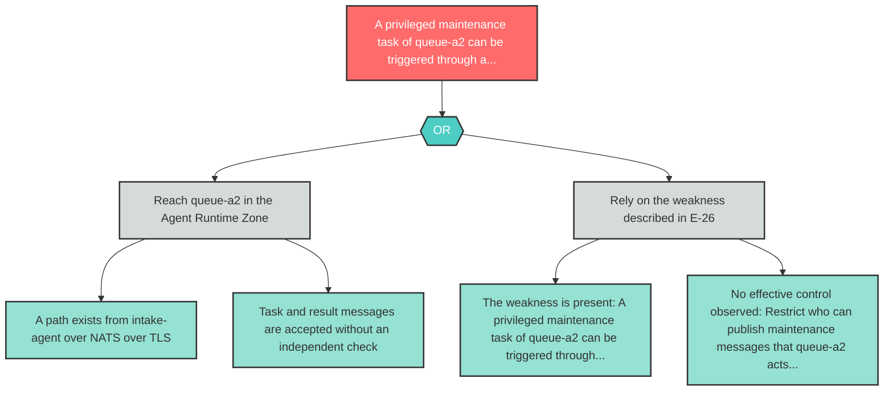

# E-26: A privileged maintenance task of queue-a2 can be triggered through...

**Component**: queue-a2 | **Risk Level**: High | **Finding**: E-26

A privileged maintenance task of queue-a2 can be triggered through a queue message that any producer on the bus may publish.

