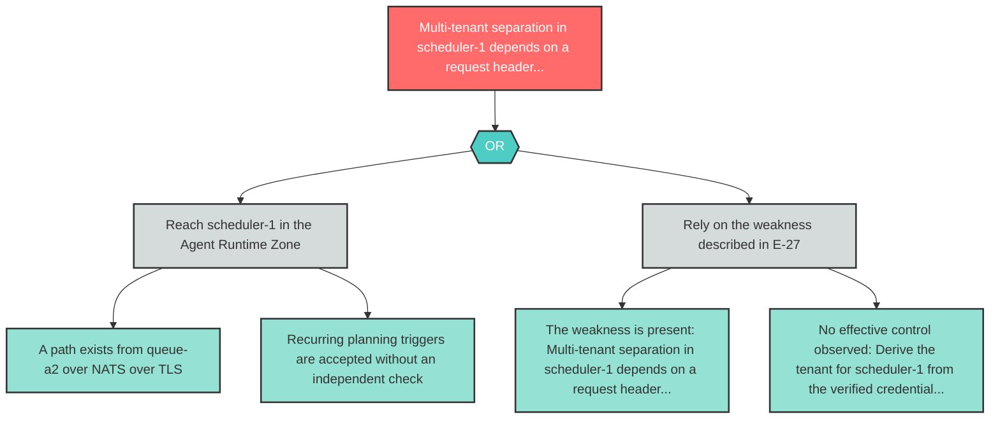

# E-27: Multi-tenant separation in scheduler-1 depends on a request header...

**Component**: scheduler-1 | **Risk Level**: High | **Finding**: E-27

Multi-tenant separation in scheduler-1 depends on a request header that clients can set, allowing one tenant to act in another's scope.

