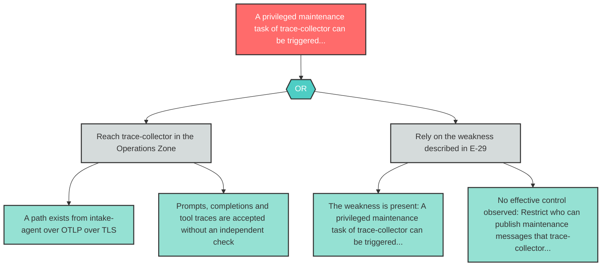

# E-29: A privileged maintenance task of trace-collector can be triggered...

**Component**: trace-collector | **Risk Level**: High | **Finding**: E-29

A privileged maintenance task of trace-collector can be triggered through a queue message that any producer on the bus may publish.

