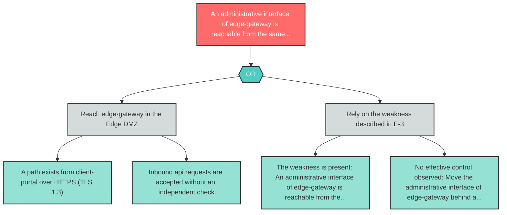

# E-3: An administrative interface of edge-gateway is reachable from the...

**Component**: edge-gateway | **Risk Level**: Critical | **Finding**: E-3

An administrative interface of edge-gateway is reachable from the same network as ordinary callers and relies on a single shared password.

