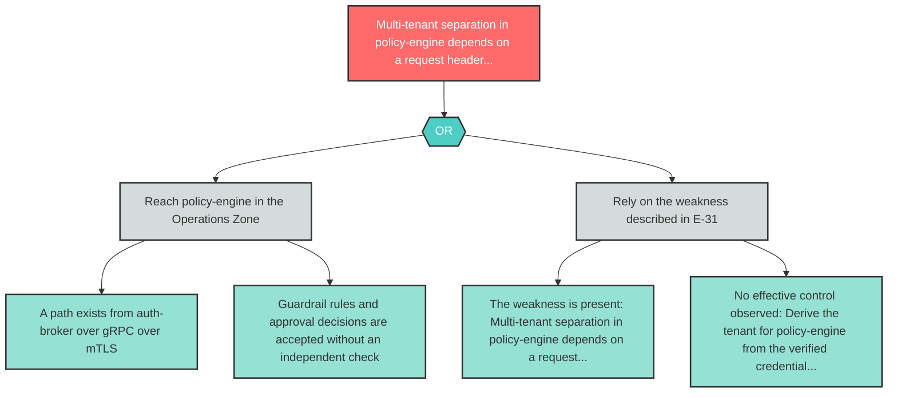

# E-31: Multi-tenant separation in policy-engine depends on a request...

**Component**: policy-engine | **Risk Level**: High | **Finding**: E-31

Multi-tenant separation in policy-engine depends on a request header that clients can set, allowing one tenant to act in another's scope.

