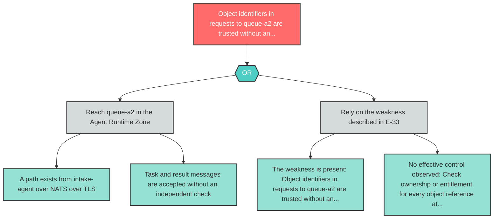

# E-33: Object identifiers in requests to queue-a2 are trusted without an...

**Component**: queue-a2 | **Risk Level**: High | **Finding**: E-33

Object identifiers in requests to queue-a2 are trusted without an ownership check, so a caller can read or change task and result messages that belong to others.

