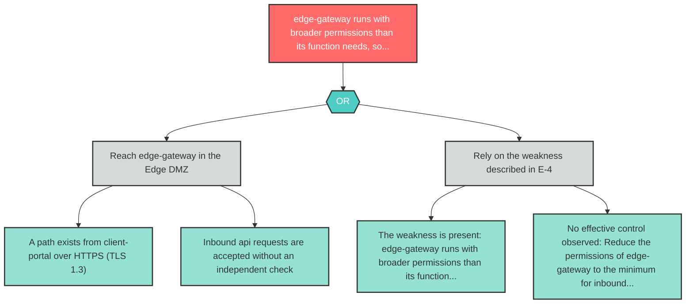

# E-4: edge-gateway runs with broader permissions than its function...

**Component**: edge-gateway | **Risk Level**: High | **Finding**: E-4

edge-gateway runs with broader permissions than its function needs, so a flaw in handling inbound API requests yields access to unrelated resources.

