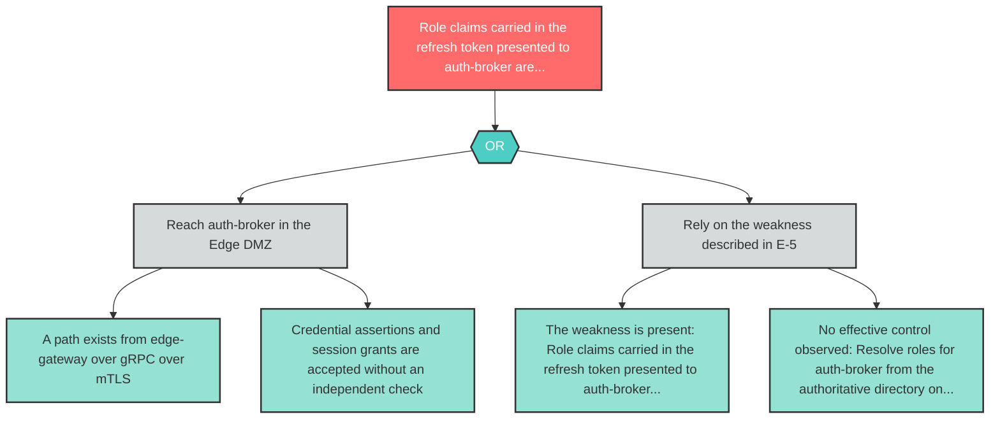

# E-5: Role claims carried in the refresh token presented to auth-broker...

**Component**: auth-broker | **Risk Level**: High | **Finding**: E-5

Role claims carried in the refresh token presented to auth-broker are honoured without confirmation against the authoritative directory.

