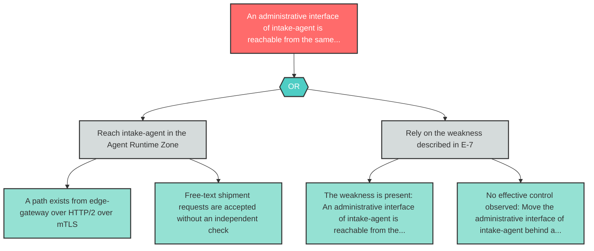

# E-7: An administrative interface of intake-agent is reachable from the...

**Component**: intake-agent | **Risk Level**: High | **Finding**: E-7

An administrative interface of intake-agent is reachable from the same network as ordinary callers and relies on a single shared password.

