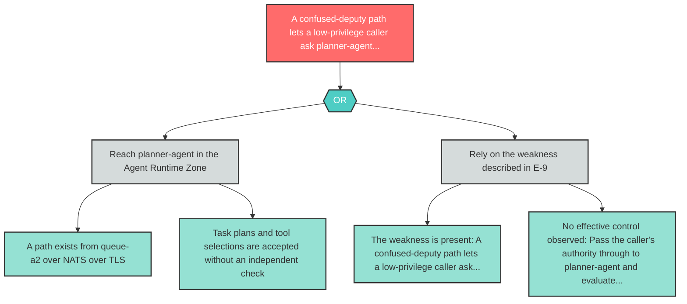

# E-9: A confused-deputy path lets a low-privilege caller ask...

**Component**: planner-agent | **Risk Level**: High | **Finding**: E-9

A confused-deputy path lets a low-privilege caller ask planner-agent to act on task plans and tool selections using the privileges of model-gateway.

