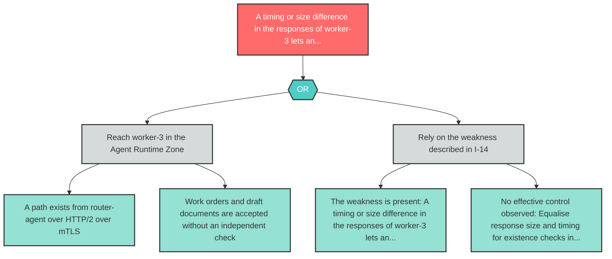

# I-14: A timing or size difference in the responses of worker-3 lets an...

**Component**: worker-3 | **Risk Level**: High | **Finding**: I-14

A timing or size difference in the responses of worker-3 lets an observer infer whether specific records of work orders and draft documents exist.

