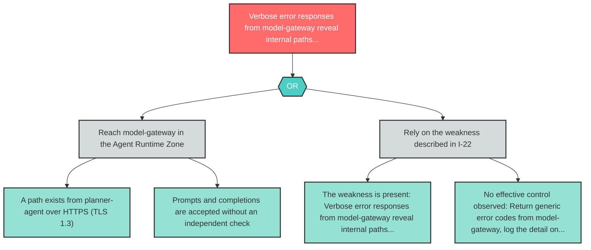

# I-22: Verbose error responses from model-gateway reveal internal paths...

**Component**: model-gateway | **Risk Level**: High | **Finding**: I-22

Verbose error responses from model-gateway reveal internal paths, query text and identifiers of prompts and completions to any caller who can trigger a failure.

