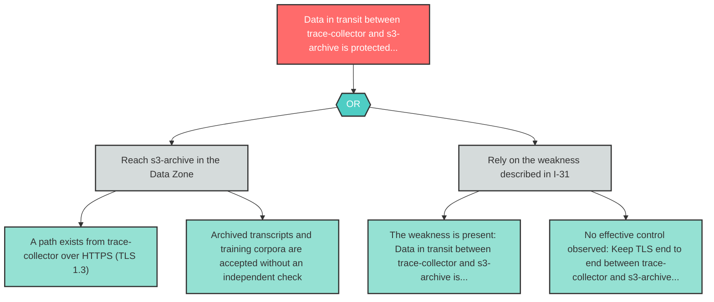

# I-31: Data in transit between trace-collector and s3-archive is...

**Component**: s3-archive | **Risk Level**: Critical | **Finding**: I-31

Data in transit between trace-collector and s3-archive is protected only on the outer hop, which leaves archived transcripts and training corpora readable on the internal segment after termination.

