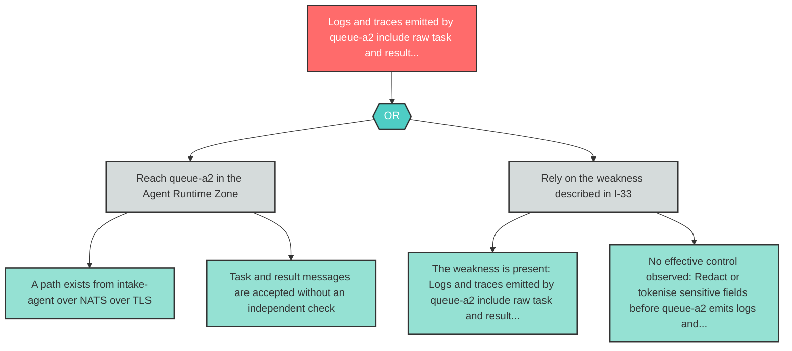

# I-33: Logs and traces emitted by queue-a2 include raw task and result...

**Component**: queue-a2 | **Risk Level**: High | **Finding**: I-33

Logs and traces emitted by queue-a2 include raw task and result messages, so anyone with access to the logging pipeline can read content meant for one tenant.

