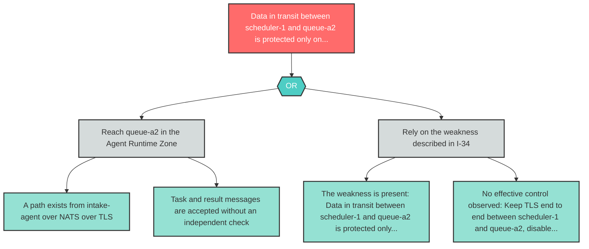

# I-34: Data in transit between scheduler-1 and queue-a2 is protected only...

**Component**: queue-a2 | **Risk Level**: High | **Finding**: I-34

Data in transit between scheduler-1 and queue-a2 is protected only on the outer hop, which leaves task and result messages readable on the internal segment after termination.

