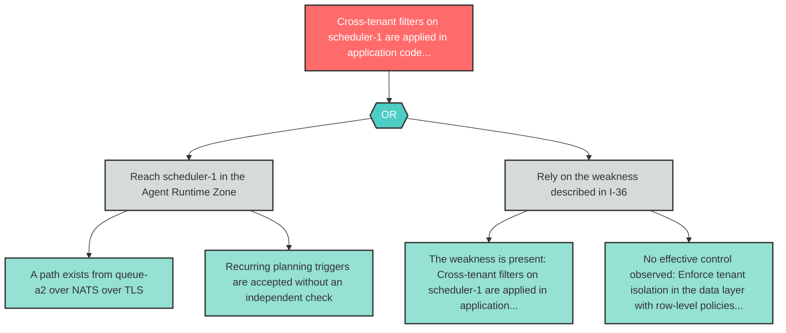

# I-36: Cross-tenant filters on scheduler-1 are applied in application...

**Component**: scheduler-1 | **Risk Level**: High | **Finding**: I-36

Cross-tenant filters on scheduler-1 are applied in application code only, so one missing predicate exposes another tenant's recurring planning triggers.

