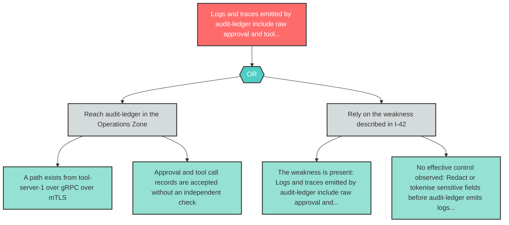

# I-42: Logs and traces emitted by audit-ledger include raw approval and...

**Component**: audit-ledger | **Risk Level**: High | **Finding**: I-42

Logs and traces emitted by audit-ledger include raw approval and tool call records, so anyone with access to the logging pipeline can read content meant for one tenant.

