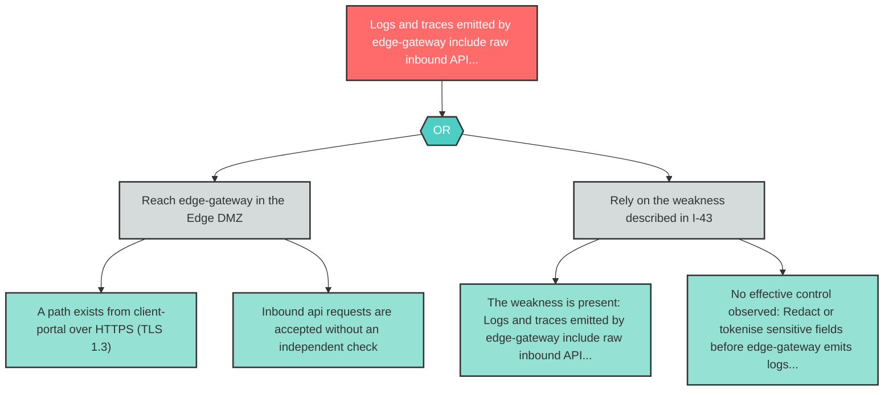

# I-43: Logs and traces emitted by edge-gateway include raw inbound API...

**Component**: edge-gateway | **Risk Level**: High | **Finding**: I-43

Logs and traces emitted by edge-gateway include raw inbound API requests, so anyone with access to the logging pipeline can read content meant for one tenant.

