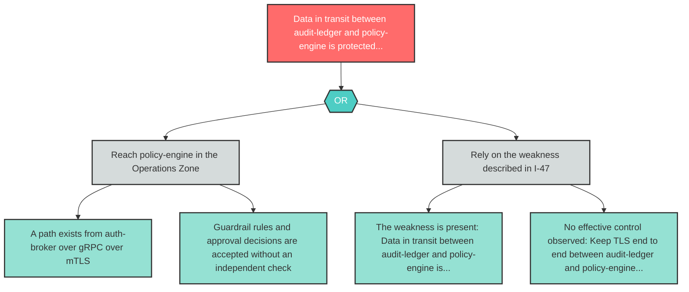

# I-47: Data in transit between audit-ledger and policy-engine is...

**Component**: policy-engine | **Risk Level**: High | **Finding**: I-47

Data in transit between audit-ledger and policy-engine is protected only on the outer hop, which leaves guardrail rules and approval decisions readable on the internal segment after termination.

