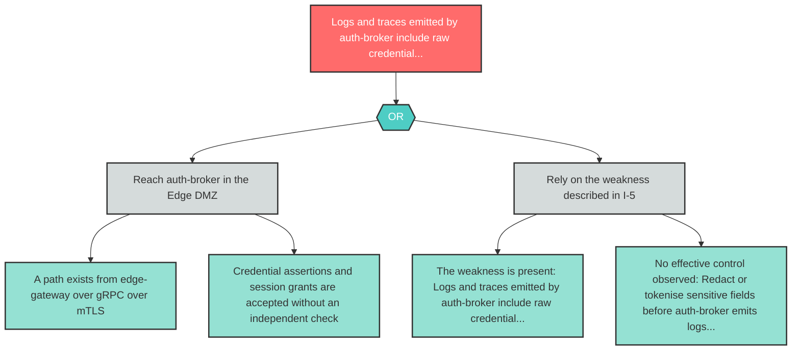

# I-5: Logs and traces emitted by auth-broker include raw credential...

**Component**: auth-broker | **Risk Level**: High | **Finding**: I-5

Logs and traces emitted by auth-broker include raw credential assertions and session grants, so anyone with access to the logging pipeline can read content meant for one tenant.

