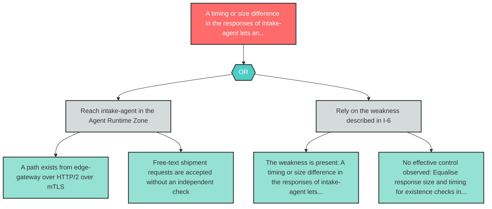

# I-6: A timing or size difference in the responses of intake-agent lets...

**Component**: intake-agent | **Risk Level**: High | **Finding**: I-6

A timing or size difference in the responses of intake-agent lets an observer infer whether specific records of free-text shipment requests exist.

