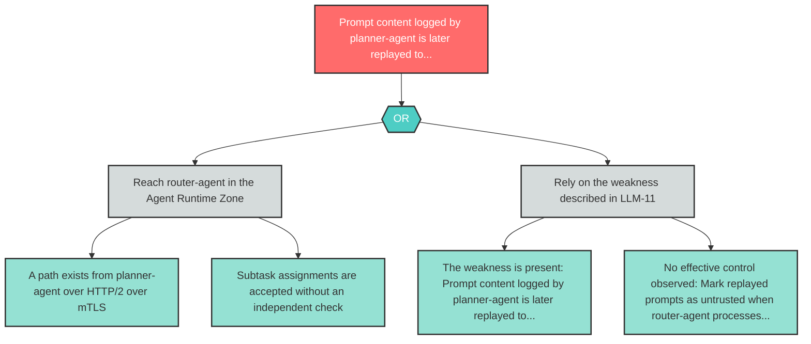

# LLM-11: Prompt content logged by planner-agent is later replayed to...

**Component**: router-agent | **Risk Level**: Critical | **Finding**: LLM-11

Prompt content logged by planner-agent is later replayed to router-agent for evaluation, carrying planted instructions into a trusted context.

