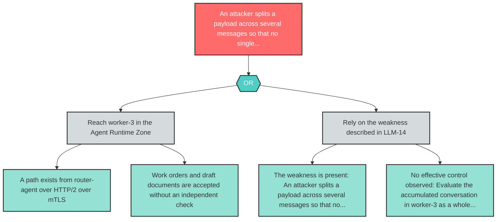

# LLM-14: An attacker splits a payload across several messages so that no...

**Component**: worker-3 | **Risk Level**: High | **Finding**: LLM-14

An attacker splits a payload across several messages so that no single message trips the filter in front of worker-3.

