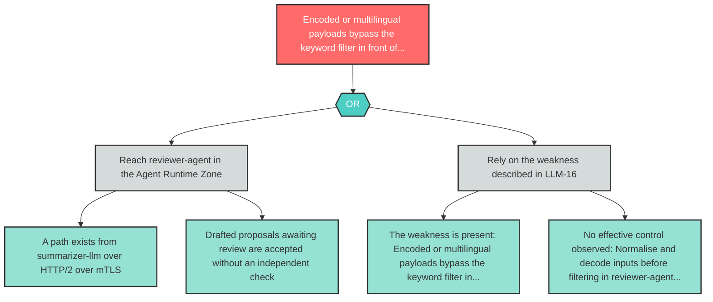

# LLM-16: Encoded or multilingual payloads bypass the keyword filter in...

**Component**: reviewer-agent | **Risk Level**: High | **Finding**: LLM-16

Encoded or multilingual payloads bypass the keyword filter in front of reviewer-agent, which only checks plain English text.

