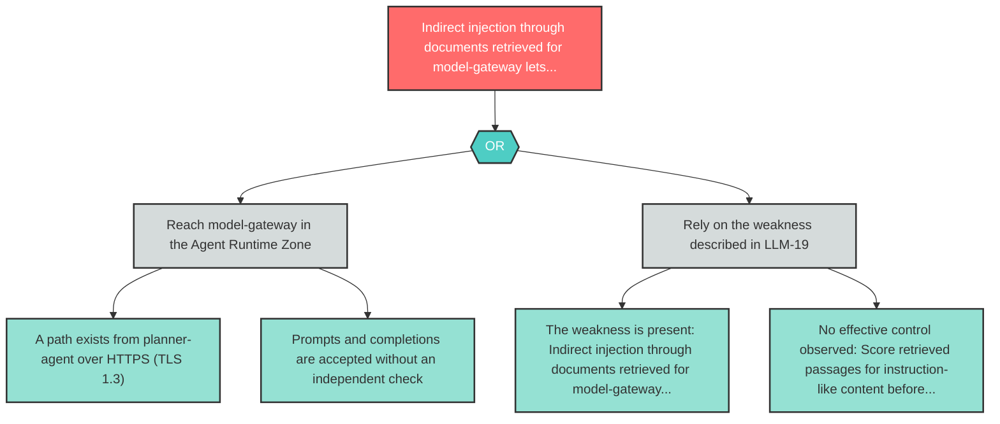

# LLM-19: Indirect injection through documents retrieved for model-gateway...

**Component**: model-gateway | **Risk Level**: Critical | **Finding**: LLM-19

Indirect injection through documents retrieved for model-gateway lets the author of a retrieved page steer the answer without ever talking to the system.

