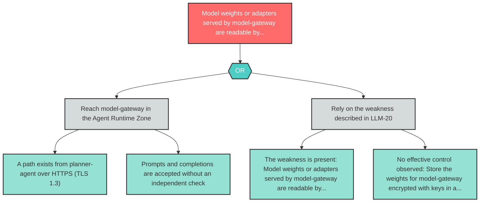

# LLM-20: Model weights or adapters served by model-gateway are readable by...

**Component**: model-gateway | **Risk Level**: Critical | **Finding**: LLM-20

Model weights or adapters served by model-gateway are readable by operators and by any process sharing the host.

