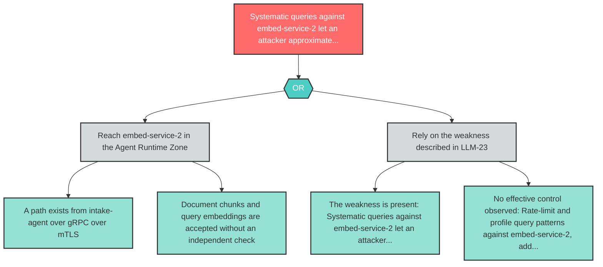

# LLM-23: Systematic queries against embed-service-2 let an attacker...

**Component**: embed-service-2 | **Risk Level**: Critical | **Finding**: LLM-23

Systematic queries against embed-service-2 let an attacker approximate the behaviour of the model and train a copy.

