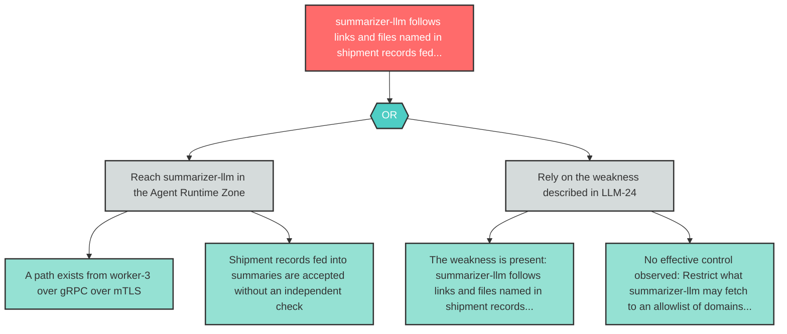

# LLM-24: summarizer-llm follows links and files named in shipment records...

**Component**: summarizer-llm | **Risk Level**: Critical | **Finding**: LLM-24

summarizer-llm follows links and files named in shipment records fed into summaries, which turns a harmless-looking request into a fetch of attacker-controlled content.

