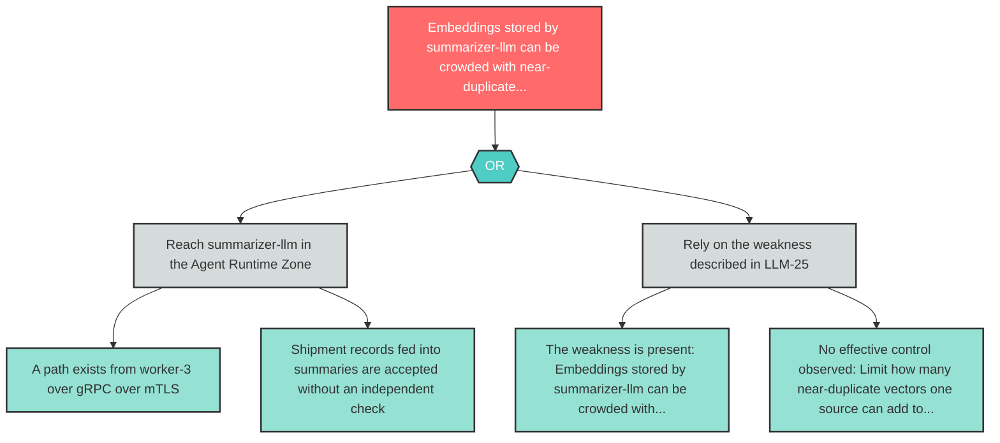

# LLM-25: Embeddings stored by summarizer-llm can be crowded with...

**Component**: summarizer-llm | **Risk Level**: High | **Finding**: LLM-25

Embeddings stored by summarizer-llm can be crowded with near-duplicate vectors that win similarity searches for chosen queries.

