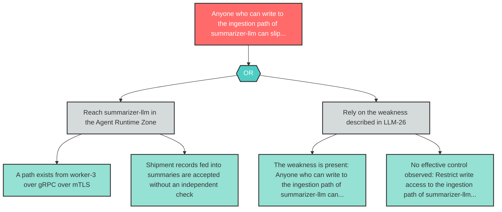

# LLM-26: Anyone who can write to the ingestion path of summarizer-llm can...

**Component**: summarizer-llm | **Risk Level**: High | **Finding**: LLM-26

Anyone who can write to the ingestion path of summarizer-llm can slip in documents that contradict authoritative sources.

