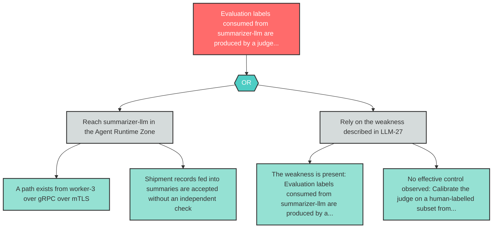

# LLM-27: Evaluation labels consumed from summarizer-llm are produced by a...

**Component**: summarizer-llm | **Risk Level**: Critical | **Finding**: LLM-27

Evaluation labels consumed from summarizer-llm are produced by a judge model that can itself be influenced by planted traces.

