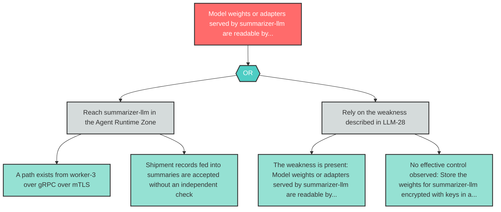

# LLM-28: Model weights or adapters served by summarizer-llm are readable by...

**Component**: summarizer-llm | **Risk Level**: Critical | **Finding**: LLM-28

Model weights or adapters served by summarizer-llm are readable by operators and by any process sharing the host.

