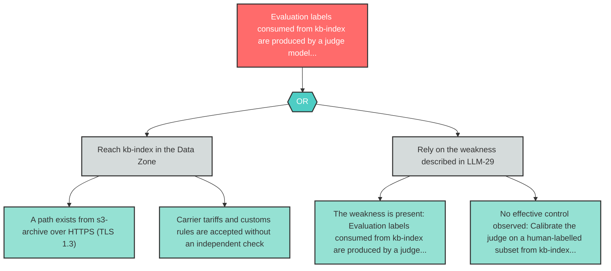

# LLM-29: Evaluation labels consumed from kb-index are produced by a judge...

**Component**: kb-index | **Risk Level**: Critical | **Finding**: LLM-29

Evaluation labels consumed from kb-index are produced by a judge model that can itself be influenced by planted traces.

