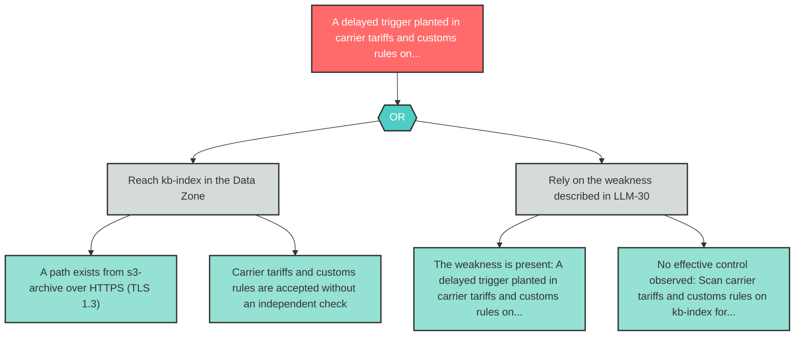

# LLM-30: A delayed trigger planted in carrier tariffs and customs rules on...

**Component**: kb-index | **Risk Level**: High | **Finding**: LLM-30

A delayed trigger planted in carrier tariffs and customs rules on kb-index changes behaviour only after a date or phrase, so pre-release testing never sees it.

