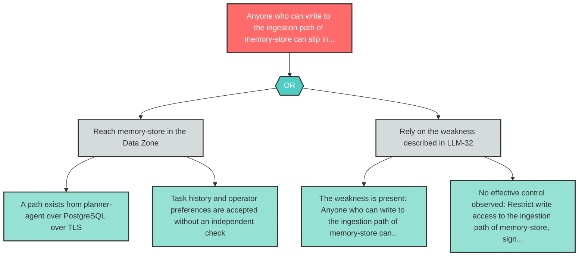

# LLM-32: Anyone who can write to the ingestion path of memory-store can...

**Component**: memory-store | **Risk Level**: High | **Finding**: LLM-32

Anyone who can write to the ingestion path of memory-store can slip in documents that contradict authoritative sources.

