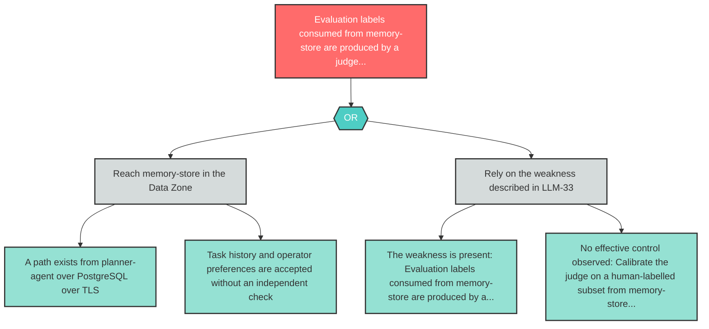

# LLM-33: Evaluation labels consumed from memory-store are produced by a...

**Component**: memory-store | **Risk Level**: Critical | **Finding**: LLM-33

Evaluation labels consumed from memory-store are produced by a judge model that can itself be influenced by planted traces.

