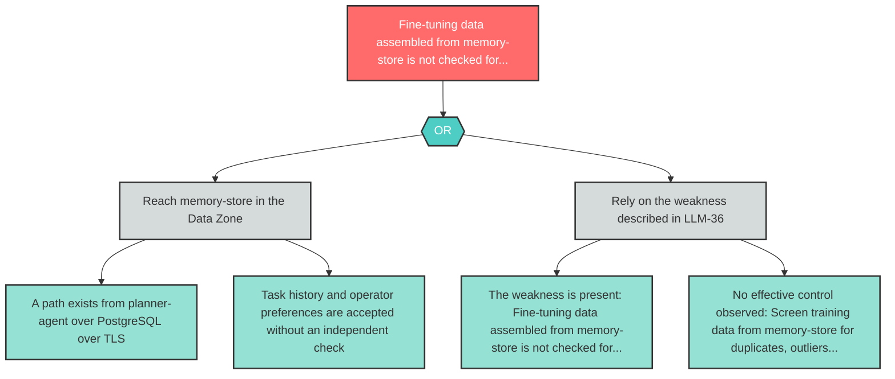

# LLM-36: Fine-tuning data assembled from memory-store is not checked for...

**Component**: memory-store | **Risk Level**: High | **Finding**: LLM-36

Fine-tuning data assembled from memory-store is not checked for outliers or duplicates, so a small batch of crafted examples changes model behaviour.

