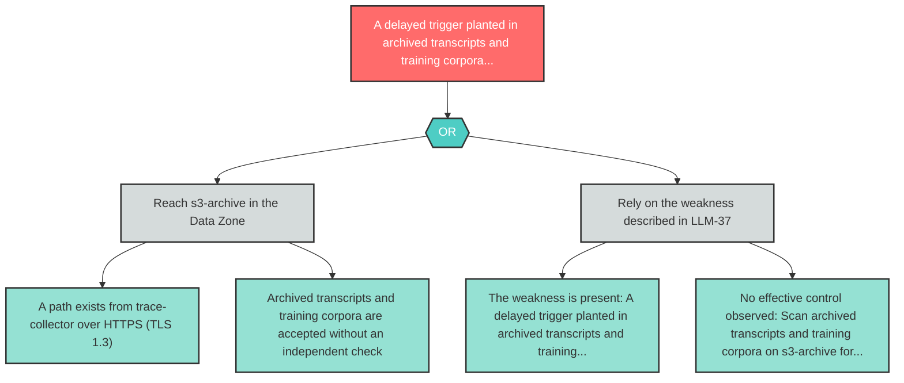

# LLM-37: A delayed trigger planted in archived transcripts and training...

**Component**: s3-archive | **Risk Level**: High | **Finding**: LLM-37

A delayed trigger planted in archived transcripts and training corpora on s3-archive changes behaviour only after a date or phrase, so pre-release testing never sees it.

