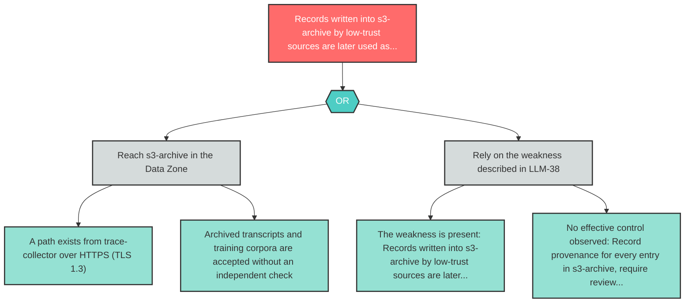

# LLM-38: Records written into s3-archive by low-trust sources are later...

**Component**: s3-archive | **Risk Level**: Critical | **Finding**: LLM-38

Records written into s3-archive by low-trust sources are later used as ground truth, so an attacker who plants entries shifts model answers.

