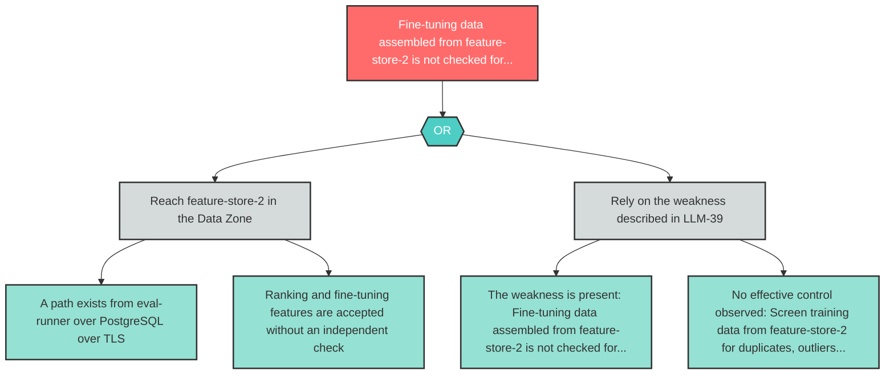

# LLM-39: Fine-tuning data assembled from feature-store-2 is not checked for...

**Component**: feature-store-2 | **Risk Level**: High | **Finding**: LLM-39

Fine-tuning data assembled from feature-store-2 is not checked for outliers or duplicates, so a small batch of crafted examples changes model behaviour.

