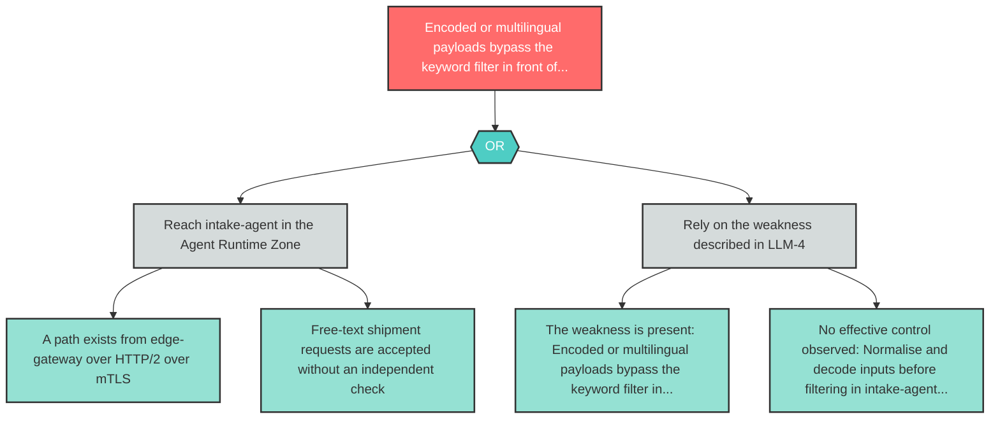

# LLM-4: Encoded or multilingual payloads bypass the keyword filter in...

**Component**: intake-agent | **Risk Level**: Critical | **Finding**: LLM-4

Encoded or multilingual payloads bypass the keyword filter in front of intake-agent, which only checks plain English text.

