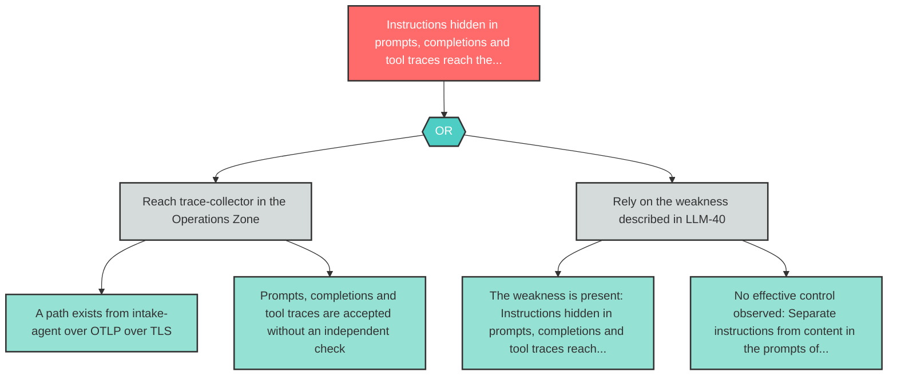

# LLM-40: Instructions hidden in prompts, completions and tool traces reach...

**Component**: trace-collector | **Risk Level**: Critical | **Finding**: LLM-40

Instructions hidden in prompts, completions and tool traces reach the prompt of trace-collector and override its system guidance, because content and instructions share one context.

