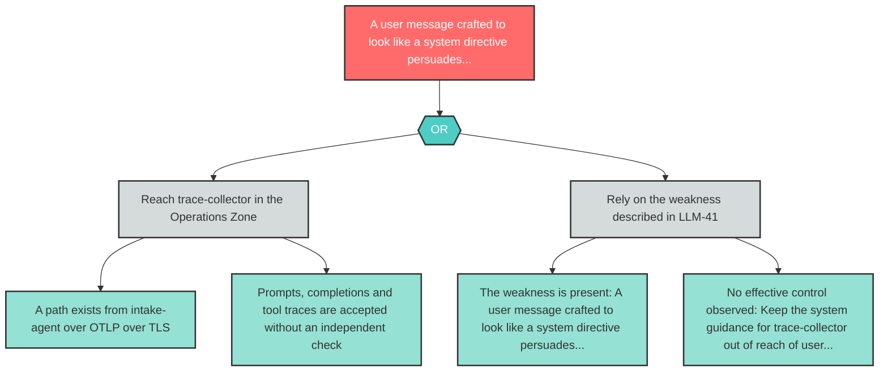

# LLM-41: A user message crafted to look like a system directive persuades...

**Component**: trace-collector | **Risk Level**: High | **Finding**: LLM-41

A user message crafted to look like a system directive persuades trace-collector to disclose its configuration or ignore its rules.

