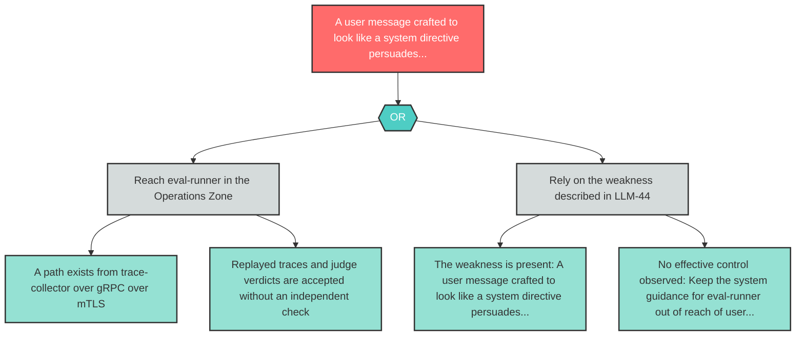

# LLM-44: A user message crafted to look like a system directive persuades...

**Component**: eval-runner | **Risk Level**: Critical | **Finding**: LLM-44

A user message crafted to look like a system directive persuades eval-runner to disclose its configuration or ignore its rules.

