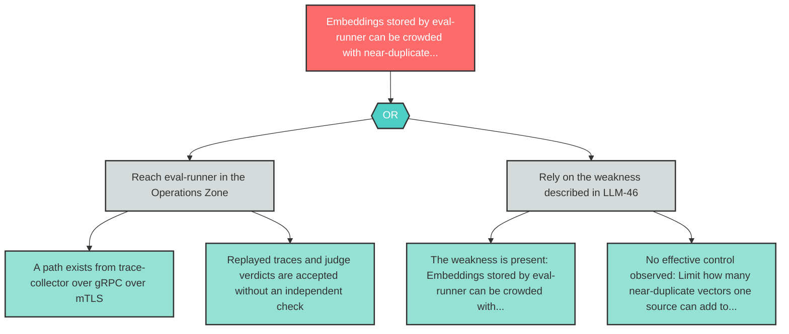

# LLM-46: Embeddings stored by eval-runner can be crowded with...

**Component**: eval-runner | **Risk Level**: Critical | **Finding**: LLM-46

Embeddings stored by eval-runner can be crowded with near-duplicate vectors that win similarity searches for chosen queries.

