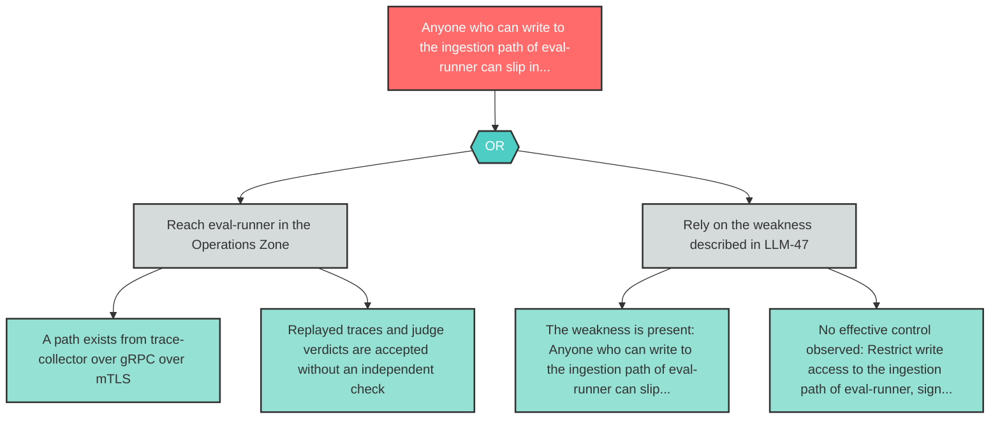

# LLM-47: Anyone who can write to the ingestion path of eval-runner can slip...

**Component**: eval-runner | **Risk Level**: Critical | **Finding**: LLM-47

Anyone who can write to the ingestion path of eval-runner can slip in documents that contradict authoritative sources.

