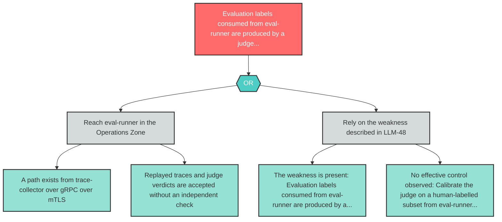

# LLM-48: Evaluation labels consumed from eval-runner are produced by a...

**Component**: eval-runner | **Risk Level**: Critical | **Finding**: LLM-48

Evaluation labels consumed from eval-runner are produced by a judge model that can itself be influenced by planted traces.

