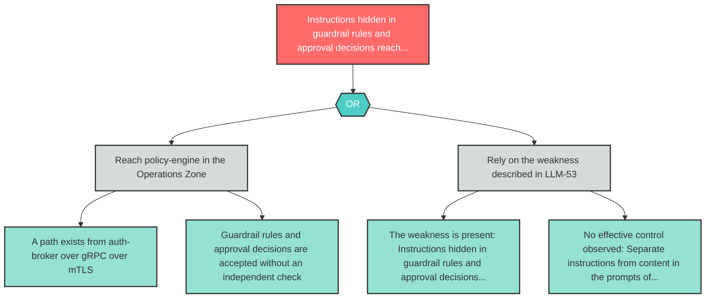

# LLM-53: Instructions hidden in guardrail rules and approval decisions...

**Component**: policy-engine | **Risk Level**: High | **Finding**: LLM-53

Instructions hidden in guardrail rules and approval decisions reach the prompt of policy-engine and override its system guidance, because content and instructions share one context.

