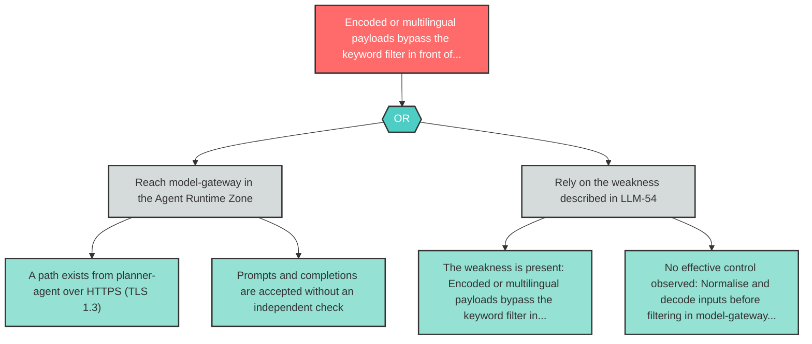

# LLM-54: Encoded or multilingual payloads bypass the keyword filter in...

**Component**: model-gateway | **Risk Level**: High | **Finding**: LLM-54

Encoded or multilingual payloads bypass the keyword filter in front of model-gateway, which only checks plain English text.

