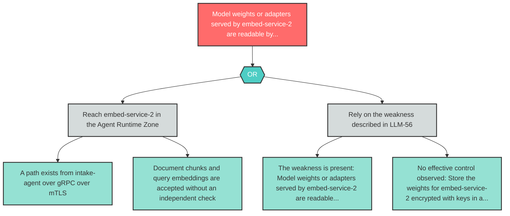

# LLM-56: Model weights or adapters served by embed-service-2 are readable...

**Component**: embed-service-2 | **Risk Level**: Critical | **Finding**: LLM-56

Model weights or adapters served by embed-service-2 are readable by operators and by any process sharing the host.

